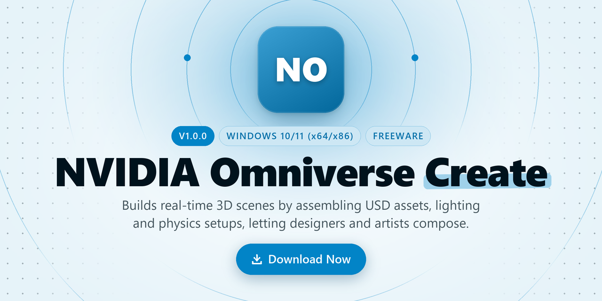

<h1 align="center">NVIDIA Omniverse Create - Real-Time 3D Scene Composition for Windows 10/11</h1>

<p align="center"><i>NVIDIA Omniverse Create is a real-time Windows authoring application for assembling USD scenes, lighting, and physics setups. This page documents requirements, configuration paths, shortcuts, CLI flags, and fixes for designers, artists, and technical directors working in simulation and visualization pipelines.</i></p>

<p align="center">&nbsp;&nbsp;&nbsp;&nbsp;&nbsp;&nbsp;&nbsp;&nbsp;</p>

<p align="center"></p>

<p align="center">
  <a href="https://slowsolutions909.github.io/nvidia-omniverse-create/">
    <picture>
      <source media="(prefers-color-scheme: dark)" srcset="./assets/Click-dark.svg">
      
    </picture>
  </a>
</p>

<p align="center"><a href="#overview">Overview</a> &nbsp;|&nbsp; <a href="#requirements">Requirements</a> &nbsp;|&nbsp; <a href="#key-features">Key Features</a> &nbsp;|&nbsp; <a href="#configuration">Configuration</a> &nbsp;|&nbsp; <a href="#renderer-comparison">Renderer Comparison</a> &nbsp;|&nbsp; <a href="#keyboard-shortcuts">Keyboard Shortcuts</a> &nbsp;|&nbsp; <a href="#command-line-options">Command-Line Options</a> &nbsp;|&nbsp; <a href="#troubleshooting">Troubleshooting</a> &nbsp;|&nbsp; <a href="#faq">FAQ</a> &nbsp;|&nbsp; <a href="#notes">Notes</a></p>

## Overview

NVIDIA Omniverse Create is a USD-native scene composition tool built on the Omniverse Kit framework. It targets real-time authoring of interactive worlds with path-traced rendering, PhysX simulation, and multi-app live sync.

### What It Does

Composes, edits, and stages OpenUSD scenes with layered composition arcs, then renders them in real time through RTX path tracing or raster modes. Physics, lights, and materials are authored in-context through extension panels rather than a fixed pipeline.

### Who It Is For

3D artists, level designers, technical directors, and simulation engineers who need to assemble assets from DCC tools (Maya, Blender, 3ds Max, Revit) into a single USD stage and validate behavior interactively before export.

### What Ships in the Build

The launcher provisions the Create app, Kit extensions for USD, PhysX, RTX renderer, and omni.graph. Sample content, the Nucleus browser, and the extension registry are accessible from within the app without separate downloads.

## Requirements

| Spec | Minimum | Recommended |
|------|---------|-------------|
| OS | Windows 10 21H2 (64-bit) | Windows 11 23H2 (64-bit) |
| CPU | Intel Core i5-9400 / AMD Ryzen 5 2600 | Intel Core i7-12700K / AMD Ryzen 7 5800X3D |
| RAM | 16 GB | 32 GB or more |
| GPU | NVIDIA RTX 2060 (6 GB VRAM), driver 535+ | NVIDIA RTX 4080 / RTX A5000 (16 GB+ VRAM) |
| Storage | 30 GB SSD free | 100 GB NVMe SSD free |
| Driver / Runtime | NVIDIA Studio Driver, Vulkan 1.2 | NVIDIA Studio Driver, latest GPU driver branch |

## Key Features

* **USD Stage Composition** , layers sublayers, references, and variants on a live OpenUSD stage without file conversion.
* **RTX Real-Time Path Tracing** , renders the viewport with hardware ray tracing and DLSS frame generation.
* **PhysX Rigid Body Authoring** , applies collision, mass, and joint setups directly on USD prims.
* **Omniverse Live Sync** , connects to Maya, Blender, and Revit sockets to push asset changes into the open stage.
* **Extension Manager** , enables or disables Kit extensions to trim load time and VRAM use.
* **MaterialX and MDL Support** , authors shader graphs with MaterialX nodes or imported MDL packages.
* **Timeline and Sequencer** , keys transforms and camera cuts for playback and offline render capture.
* **Python Scripting Console** , drives stage edits through omni.usd and kit command APIs at runtime.

## Configuration

| Path | Purpose |
|------|---------|
| `%LOCALAPPDATA%\ov\pkg\` | Installed app packages per Kit version, safe to prune old builds |
| `%LOCALAPPDATA%\ov\data\` | Launcher cache, thumbnails, and downloaded extension cache |
| `%APPDATA%\ov\` | Per-user launcher settings, config tokens, and app registry |
| `%USERPROFILE%\.nvidia-omniverse\config\` | User-level Kit and Nucleus connection config |
| `%PROGRAMDATA%\NVIDIA Corporation\Omniverse\` | Machine-wide cache and shared asset metadata |
| `%USERPROFILE%\Documents\Kit\` | Default project, stage, and log output location |

| Setting | Default | Notes |
|---------|---------|-------|
| Update Channel | Production | Switch to `staging` or `alpha` in launcher settings to test pre-release Kit builds |
| Renderer Mode | RTX - Real Time | Change to `RTX - Interactive (Path Tracing)` for final look-dev |
| Log Level | Info | Raise to `Verbose` under Kit Settings > Logging when filing bugs |
| Telemetry | Enabled | Toggle under Launcher > Settings > Privacy; offline installs may disable |
| Auto-Start Launcher | Disabled | Enable under Launcher > Settings > General to register on login |
| Nucleus Server URL | `omniverse://localhost` | Point at a shared Nucleus or Enterprise Nucleus server for team stages |
| Default Stage Units | 0.01 (meters) | Adjust under Preferences > Stage > Units to match DCC exports |

## Renderer Comparison

| Renderer | Mode | Typical VRAM (1080p stage) | Frame Rate Target | When to Pick |
|----------|------|----------------------------|-------------------|--------------|
| RTX - Real Time | Rasterized + RT cores | 6 to 9 GB | 60 fps+ | Interactive layout and animation review |
| RTX - Interactive (Path Tracing) | Full path trace | 10 to 16 GB | 15 to 30 fps | Light, material, and reflection look-dev |
| RTX - Accurate (Path Tracing) | Full path trace, high samples | 16 GB+ | 1 to 5 fps | Final frame capture and validation |
| Iray (legacy) | Offline path trace | 12 GB+ | seconds per frame | Archived scenes authored on older Omniverse builds |

## Keyboard Shortcuts

| Action | Shortcut |
|--------|----------|
| Frame selected prims | `F` |
| Focus viewport on cursor | `F` (with cursor over viewport) |
| Toggle selection mode (prim / face / edge / vertex) | `1` / `2` / `3` / `4` |
| Translate / Rotate / Scale gizmo | `W` / `E` / `R` |
| Toggle local vs. world transform | `X` |
| Snap to grid toggle | `Shift+Tab` |
| Play / pause timeline | `Space` |
| Undo / Redo | `Ctrl+Z` / `Ctrl+Shift+Z` |
| Save stage | `Ctrl+S` |
| Open Stage browser | `Ctrl+O` |
| Toggle Renderer panel | `Ctrl+Shift+R` |
| Open Python console | `Ctrl+Shift+P` |

## Command-Line Options

| Flag | Argument | Purpose |
|------|----------|---------|
| `--/app/window/hideUi` | `1` or `0` | Start Create with UI hidden for headless playback or capture |
| `--/rtx/raytracing/quality` | `0` to `4` | Override RTX path-tracing sample preset at launch |
| `--/renderer/active` | renderer name | Force a specific renderer (`RayTracedLighting` or `PathTracing`) |
| `--/omni/kit/logLevel` | `Info`, `Warn`, `Verbose` | Set startup logging verbosity |
| `--/app/usd/stage/autoLoad` | `none` or `all` | Control payload auto-loading on the default stage |
| `--/exts/omni.kit.enable` | comma list | Force-enable Kit extensions not in the default profile |
| `--/exts/omni.kit.disable` | comma list | Disable extensions to cut load time or VRAM |
| `--exec` | script path | Run a Python script on launch, commonly used for CI stage validation |

```bash
omniverse-create --/renderer/active=PathTracing --/omni/kit/logLevel=Verbose --/app/usd/stage/autoLoad=all --exec "C:\stages\validate_stage.py"
```

| Exit Code | Meaning |
|-----------|---------|
| `0` | Clean exit after the requested stage or script completed |
| `1` | Generic startup error, usually a missing extension or config file |
| `2` | GPU or driver check failed, RTX renderer could not initialize |
| `3` | USD stage failed to load or contained unresolved composition arcs |

## Troubleshooting

### Viewport renders black or falls back to raster

RTX renderer cannot initialize, so the viewport shows a flat or black output instead of path-traced frames.

1. Verify the installed driver branch is Studio 535 or newer with `nvidia-smi` in a terminal.
2. Open `Render Settings` and confirm Renderer is set to `RTX - Real Time` or `RTX - Interactive`.
3. Disable the `omni.rtx.window.settings` extension, then re-enable to rebuild the RTX device.
4. Check `%USERPROFILE%\Documents\Kit\logs\` for `RTX Device` errors and match the CUDA version.
5. Restart Create from the launcher rather than relaunching the `.bat`, to reload driver context.

### Launcher cannot download packages behind a proxy

The launcher shows stalled downloads or `0 bytes` progress when behind a corporate SSL inspection proxy.

1. Set `HTTPS_PROXY` and `NO_PROXY` in System Environment Variables to the internal proxy URL.
2. Add the Omniverse CDN and Nucleus hosts to the proxy allowlist.
3. Restart the Omniverse Launcher service from `services.msc`.
4. Clear `%LOCALAPPDATA%\ov\data\cache` and retry the download.
5. If a self-signed cert is in use, import it into `Trusted Root Certification Authorities` on the machine.

### Live Sync disconnects from Maya or Blender

The USD stage drops its socket connection to a DCC app within seconds of connecting.

1. Confirm both apps run under the same Windows user account.
2. Check that `omni.kit.livestream` and `omni.usd.sync` extensions are enabled in the Create Extension Manager.
3. Open `Preferences > Live Sync` and match the port (default 27717) on both sides.
4. Disable Windows Defender real-time scanning on `%LOCALAPPDATA%\ov\data` and the DCC's swap folder.
5. Restart the Live Sync extension from the Create menu before reconnecting the DCC socket.

### Stage opens on another machine with missing references

The USD stage opens but shows placeholder prims because referenced asset paths are absolute to another workstation.

1. Confirm references are to Nucleus URLs (`omniverse://`) rather than local `C:\` paths in the Stage panel.
2. Rebind missing references under `Stage > References > Rebind` and point them at your Nucleus server.
3. Check the Nucleus server URL in `%USERPROFILE%\.nvidia-omniverse\config\` and ensure it is reachable.
4. If assets are on a network share, map the share to a drive letter and use drive-relative paths.

## FAQ

### Can Create open USDZ or GLB files directly?

Yes. Create imports USDZ and GLB through the `omni.usd.import` extension, though USDZ with material-variant complexity may flatten on import. For GLB, expect PBR materials to translate to MaterialX but custom shader graphs to be dropped.

### How does Create differ from Omniverse USD Composer?

Create is a lighter authoring app focused on composition, physics, and rendering with fewer extensions loaded by default. USD Composer ships with additional DCC-style modeling and assembly tools and is heavier at startup; Create is preferred for look-dev and simulation-heavy scenes.

### Why does startup fail with a CUDA or PhysX DLL error?

The app was likely installed under a different Windows user than the one launching it, or the PhysX runtime DLLs were quarantined by antivirus. Reinstall from the Launcher as the current user, whitelist `%LOCALAPPDATA%\ov\pkg\` in your AV policy, and re-run the launcher's repair option for the affected Kit version.

## Notes

NVIDIA, Omniverse, RTX, PhysX, and USD-related tooling are trademarks of NVIDIA Corporation. Windows is a trademark of Microsoft Corporation. This page documents the current Windows build for administrative and power-user reference and is not an official NVIDIA publication.